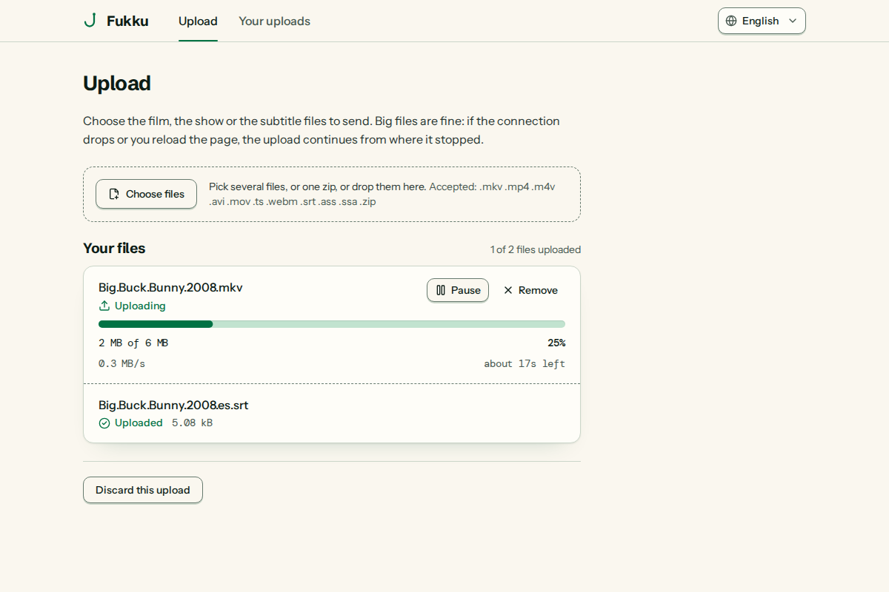
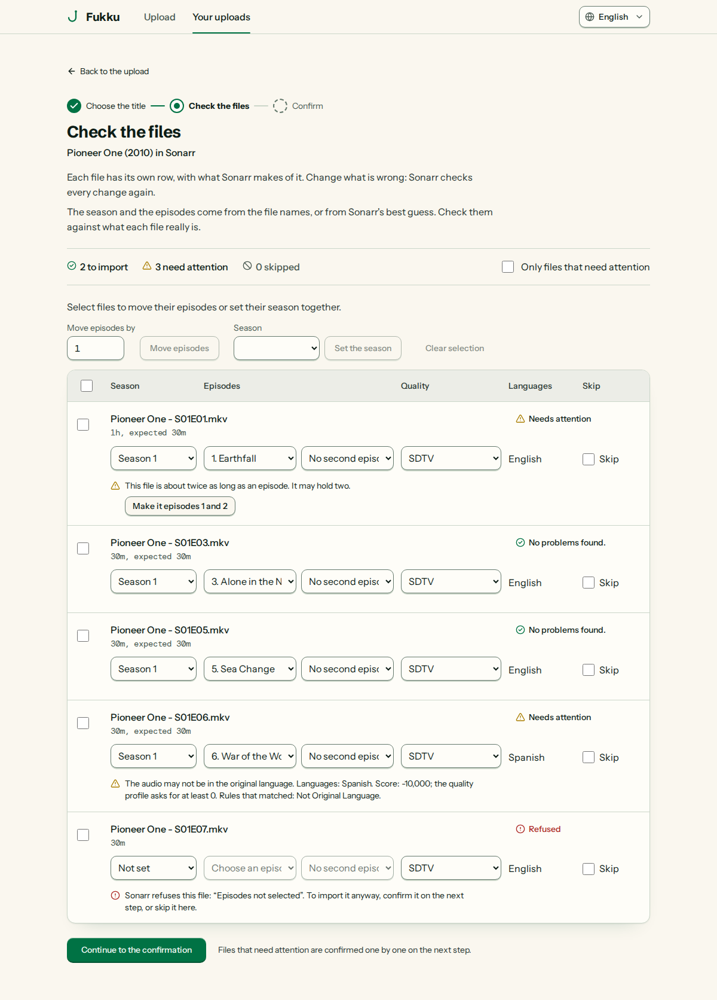
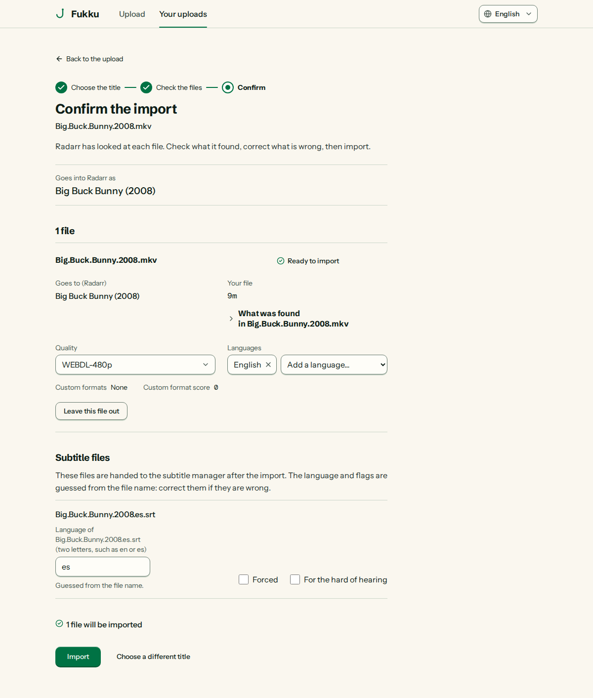
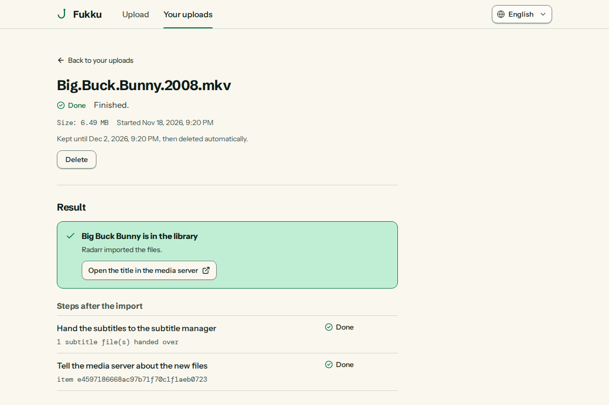
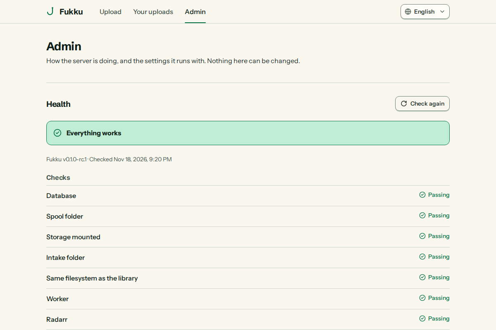

# Fukku

**Status: first release.** It is ready to run against a real library, behind a reverse proxy that
authenticates your users. Back up your library as you always do: Radarr and Sonarr stay the
only writers of it, but a merge replaces a film's file (see [docs/install.md](docs/install.md)).

Fukku (フック, "hook") is a small self-hosted web app for adding video that no indexer will
ever provide (a ripped disc, a home recording, another language of a film you already have,
a zipped season) to a Radarr and Sonarr library. You upload in the browser. Fukku checks the
upload, asks Radarr or Sonarr what they make of it, and lets you confirm. Then **Radarr or
Sonarr import it through their own Manual Import API**, so their naming, quality and upgrade
logic stay in charge, and the media server, the subtitle manager and request apps see it like
a normal download.

- **Radarr and Sonarr stay the only writers of the library.** Fukku never renames or files
  media itself. The one exception is opt-in second versions (a dub kept next to the
  original), placed as hard links that never replace a file.
- **Built for untrusted uploads.** A separate worker process with no network and no
  credentials opens the uploaded files. Archives are extracted with limits, and nothing is
  ever overwritten.
- **Every deployment-specific behaviour is a setting**, with a default
  ([docs/settings.md](docs/settings.md)).
- **Easy to run:** one OCI image, two containers, configuration by environment variables or
  one YAML file, behind any reverse proxy.

How the tested versions of Radarr, Sonarr, Bazarr and Jellyfin behave is in
[docs/compatibility.md](docs/compatibility.md). What Fukku defends against, and what it
accepts, is in [docs/threat-model.md](docs/threat-model.md); how to report a vulnerability is in
[SECURITY.md](SECURITY.md).

## What it looks like

Upload one or more files, or a zip of a season, in the browser:

Fukku asks Sonarr what it makes of each file of a season and shows it, with what needs a look:
a file that may hold two episodes, a dub, a file Sonarr refuses. Correct what is wrong:

Confirm what Radarr will import, with the subtitles' languages:

Radarr imports it, and the job ends with a link to the title in your media server:

Administrators see the server's health and the settings it runs with:

## What it needs

- Docker with Compose v2.12 or later (for the compose example's `create_host_path: false`),
  and **Radarr** and/or **Sonarr** (v3 API; the tested versions are in
  [docs/compatibility.md](docs/compatibility.md)). Bazarr and Jellyfin are optional.
- **One filesystem** for the intake folder and the library when Radarr and Sonarr import by
  moving (the default), mounted at the same path in every container.
- **A reverse proxy that authenticates your users** and sets `Remote-User` (and optionally
  groups and email) headers: Caddy, Traefik, nginx and others. Fukku has no log-in page of its
  own and refuses requests that did not come through the proxy.

## Install in five steps

The full guide, with the reasons, is [docs/install.md](docs/install.md). In short:

1. **Copy the examples** [deploy/compose.example.yaml](deploy/compose.example.yaml) and
   [deploy/fukku.example.yaml](deploy/fukku.example.yaml) into one folder as `compose.yaml` and
   `fukku.yaml`, and create `state/data`, `state/spool` and `secrets/` there, and the intake
   folders `intake/jobs`, `intake/worker` and `intake/.incoming` in your data folder, as the user
   that owns your media (the commands are in [docs/install.md](docs/install.md), step 1: the
   containers refuse to start on a missing intake folder).
2. **Put the API keys in files** under `secrets/` (`radarr_api_key`, `sonarr_api_key`, and
   `bazarr_api_key` and `jellyfin_api_key`). The compose file needs all four files: for an app
   you do not use, take it out of both files as [docs/install.md](docs/install.md), step 3, says.
3. **Edit both files**: the data folder, the user id, the network your apps share, your public
   address (`server.publicBaseUrl`), the root folders and quality profiles, and who is an admin
   (`auth.adminGroup`, which your proxy must send in the groups header, or
   `auth.allUsersAreAdmins`). Check them:
   `docker compose run --rm --no-deps web check-config`.
4. **Start it**: `docker compose up -d`, and wait for both containers to be `healthy`
   (`docker compose ps`).
5. **Put your reverse proxy in front of it**, with worked examples for Caddy, Traefik and nginx
   in [docs/reverse-proxy.md](docs/reverse-proxy.md), then open your address.

The image is `ghcr.io/segun-io/fukku`, for amd64 and arm64.

## Your first upload

Open **Upload**, choose a video (or several, or a zip of a season), press **Start upload**,
then choose the film or show it is, check what Radarr or Sonarr made of each file, and press
**Import**. Radarr or Sonarr do the import itself, and the job ends with a link to the title in
your media server. A dropped connection or a reload continues where it stopped. With a film
that is already in the library, an upload in another language is offered as a merge into the
file or as a second version.

## Where to get help

[docs/troubleshooting.md](docs/troubleshooting.md) covers the usual problems (not ready, 403,
stalled uploads, not the same filesystem, stuck jobs, the manual fallback). Every setting is in
[docs/settings.md](docs/settings.md). Bugs and questions go to the project's
[issues](https://github.com/segun-io/fukku/issues). Backup and restore:
[docs/backup.md](docs/backup.md).

The web process keeps its state in one SQLite file in `server.dataDir` (local disk only).
Commands, for reference: `fukku web`, `fukku worker`, `fukku combined` (one process, weaker),
`fukku check-config`, `fukku healthcheck` and `fukku version`; the image runs `web` by default.
Pre-release images are described in [docs/prerelease.md](docs/prerelease.md).

## Metrics

Set `server.metrics: true` (`FUKKU_SERVER_METRICS=true`) and the web process serves Prometheus
metrics on `/metrics`: uploads in flight and their bytes, bytes received, jobs by state, worker
task durations by kind and outcome, imports by app and outcome (submitted, imported, failed), and readiness per check. No
label carries a user, file name or title. Like `/readyz`, it is open to a loopback address and
otherwise needs an admin through the reverse proxy, so a scraper on the same host needs no
credentials; with the setting off the path is a 404. See [docs/settings.md](docs/settings.md).

## Contributing

How to build Fukku, run it next to a local test Radarr, Sonarr, Bazarr and Jellyfin, and test
it is in [docs/development.md](docs/development.md). The rules for a change are in
[CONTRIBUTING.md](CONTRIBUTING.md).

## Licence

[AGPL-3.0](LICENSE).
