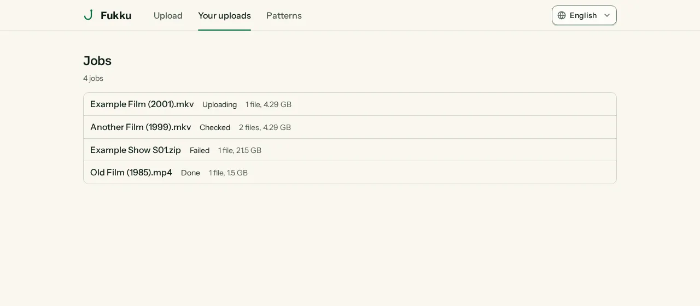
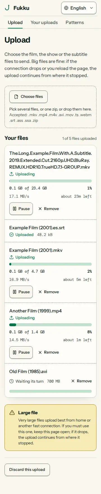

# Design

How the Fukku UI looks, sounds and behaves, and which component or token to reach for. The
pages are built from what is described here; a page that needs something new adds it to
`ui/src/components/patterns/` and to this file, not to the page.

See every pattern with sample data at `/design`: `cd ui && npm run dev:mock`, then open
`/design` (`dev:mock` answers the API in the browser, so no backend is needed). The route
exists in development builds only; a built binary answers it with the not-found page.

What it looks like (the header shows "Patterns" only in development builds):

| | 360 px | Desktop |
| --- | --- | --- |
| Shell, light | [English](design/shell-360-light.webp), [Spanish](design/shell-360-light-es.webp) | [English](design/shell-desktop-light.webp) |
| Shell, dark | [English](design/shell-360-dark.webp) | [English](design/shell-desktop-dark.webp) |
| Patterns, light | [English](design/patterns-360-light.webp), [Spanish](design/patterns-360-light-es.webp) | [English](design/patterns-desktop-light.webp) |
| Patterns, dark | [English](design/patterns-360-dark.webp) | [English](design/patterns-desktop-dark.webp) |

When a pattern or a token changes its look, take these again. The upload and job pages,
before and after the direction was applied to them, are in §13.

## 1. Direction

Fukku is used by people who are not technical, often on a phone, to send very large files
over connections that drop, and then to make a few careful decisions. The UI is **calm,
exact and unhurried**, like the label a pharmacist puts on a box: the name, the amount,
the time, what to do next. It lives in a kitchen, not in a control room.

- **Paper and one green.** Warm paper, green-black ink, one green that does every signal:
  the action, the progress, what is done. Nothing else is coloured unless it has a meaning
  from the table in §3.
- **The file label is the signature.** A file is its name over its figures (size, speed,
  time left) in a monospaced face, and a mint tray that fills. That object appears wherever
  a file is uploading; it is what people remember of the app.
- **Nothing moves by itself.** Only the tray's fill moves, because bytes moved. No entrance
  animation, no pulse, no spinner where a figure can say more. A number that changes never
  pushes its neighbours.
- **Words before colour.** Every state says in words what happened and what to do. Colour
  and icons repeat the message; they never carry it alone.
- **Rows on paper, not cards.** Content sits on the page, divided by hairlines. One raised
  surface is allowed per group (the strip of file labels); never a card inside a card.

The direction is the Hallmark theme *Dose* (grounds "white" and "night"), reduced for an
app: its plastic tints, paper grain and window light are left out.

## 2. Where things are

| What | Where |
| --- | --- |
| Tokens (every colour, face, radius, shadow, duration) | `ui/src/tokens.css` |
| Fonts and their licences | `ui/src/fonts.css`, `ui/src/assets/fonts/` |
| Element defaults (body, headings, focus ring, reduced motion) | `ui/src/base.css` |
| Restyling of shadcn/ui components, `.figure`, `.tray`, `.shell-container` | `ui/src/index.css` |
| The shell and its states | `ui/src/components/shell/` |
| The patterns | `ui/src/components/patterns/` |
| shadcn/ui components, unmodified | `ui/src/components/ui/` |
| Strings and formatters | `ui/src/i18n/` (`en.ts`, `es.ts`; this document covers the keys `shell.*` and `patterns.*`) |

**Rules for code**

- No literal colour and no `font-family` outside `tokens.css` and `fonts.css`. Tailwind's
  stock palette is switched off (`--color-*: initial`), so `bg-red-500` produces nothing.
- shadcn/ui components are not edited. They are restyled through the tokens and through
  the `[data-slot]` rules in `index.css`. (One exception: `button.tsx` lists its
  transitioned properties instead of `transition-all`.) Add components with the shadcn CLI
  as usual; they pick the theme up.
- Never `transition: all`; animate `transform` and `opacity` only.
- Every string goes through `t()`. Every number, size, speed, duration and date goes
  through the formatters of `useT()`.

## 3. Colour

Light and dark are two renderings of the same tokens; dark follows the system setting
(`prefers-color-scheme`) and there is no switch. Hues are the same in both; lightness is
derived again. Use the Tailwind utility in the second column, never the raw variable.

| Role | Utility | Light | Dark | Use |
| --- | --- | --- | --- | --- |
| Paper | `bg-background` | `oklch(97.6% 0.011 88)` | `oklch(16.5% 0.012 170)` | the page |
| Raised paper | `bg-card` | `oklch(99.3% 0.006 88)` | `oklch(21% 0.015 168)` | the one raised surface of a group; inputs; outline buttons |
| Quiet fill | `bg-muted` | `oklch(94.4% 0.008 110)` | `oklch(19.5% 0.014 168)` | "waiting" notices, bands |
| Hover fill | `bg-accent`, `bg-secondary` | `oklch(92.4% 0.034 160)` | `oklch(26% 0.024 162)` | hover, skeleton bars, grey markers |
| Ink | `text-foreground` | `oklch(21% 0.025 170)` | `oklch(95% 0.012 160)` | headings, names, values |
| Ink 2 | `text-ink-2` | `oklch(31% 0.02 170)` | `oklch(86% 0.014 162)` | body sentences under a heading |
| Ink 3 | `text-muted-foreground` | `oklch(44% 0.024 165)` | `oklch(72% 0.02 165)` | captions, secondary figures, what has not happened yet |
| Hairline | `border-border` (the default border) | `oklch(86.5% 0.022 140)` | `oklch(31% 0.02 160)` | dividers, surface edges |
| Control edge | `border-input` | `oklch(56% 0.03 160)` | `oklch(54% 0.03 160)` | edges of inputs and outline buttons (3:1 on paper) |
| Green | `bg-primary`, `text-primary` | `oklch(48% 0.125 160)` | `oklch(76% 0.115 160)` | the primary button, progress, done, the current step |
| On green | `text-primary-foreground` | `oklch(99% 0.006 160)` | `oklch(17% 0.02 170)` | text on a green fill |
| Mint | `bg-primary-soft` | `oklch(91% 0.06 160)` | `oklch(30% 0.05 160)` | a "done" notice |
| Tray | `bg-track` | `oklch(88.5% 0.045 160)` | `oklch(29% 0.035 160)` | the empty part of a progress tray |
| Error | `text-destructive`, `bg-destructive` | `oklch(49% 0.17 27)` | `oklch(72% 0.15 25)` | failed, refused |
| Error fill | `bg-destructive-soft` | `oklch(94.5% 0.028 27)` | `oklch(26% 0.05 25)` | behind the reason of a failure |
| Caution fill | `bg-caution`, `border-caution-edge`, `text-caution-foreground` | `oklch(94% 0.07 98)` | `oklch(27% 0.045 95)` | warnings before a decision; "sign in again" |
| Alarm | `bg-alarm`, `text-alarm-foreground` | `oklch(87% 0.16 98)` | the same | the insecure-development banner, nothing else |
| Focus | `ring-ring` (the outline is set globally) | `oklch(45% 0.14 160)` | `oklch(80% 0.12 160)` | the focus ring |

Text pairs are 4.5:1 or better and control edges, the tray's fill and the focus ring 3:1 or
better, in both modes.

### The four meanings

A state has exactly one of four meanings. Pick the meaning first; the colour follows.

| Meaning | Colour | Icon (lucide) | States |
| --- | --- | --- | --- |
| **Moving or done** | green | `Upload`, `CircleCheck`, `Check` | uploading, uploaded, accepted, a finished step |
| **Waiting**: it continues by itself, or waits for its turn | grey (`text-muted-foreground`, `bg-muted`) | `Clock`, `Pause`, `WifiOff`, `Hourglass`, `Ban`, `CircleDashed` | queued, paused, waiting for the connection, stalled, cancelled, not checked yet, an upload nobody is sending right now |
| **Needs a person** | red | `CircleAlert`, `CircleX` | upload stopped, job failed, file refused |
| **Read before you decide** | yellow | `TriangleAlert`, `LogIn`, `FilePlus2` | warnings in a confirmation, sign in again, choose the files of an interrupted upload again |

A paused or stalled thing is never red: nothing is wrong, and red would ask for an action
that does not exist. The alarm yellow is not one of the four; it marks a server that must
not be used with real files.

## 4. Type

Three faces, all SIL Open Font License 1.1, vendored as variable or static WOFF2 and served
from the app itself (latin and latin-ext; the app works with no internet).

| Face | Utility | Weights | Use |
| --- | --- | --- | --- |
| Schibsted Grotesk | `font-display` (set on `h1`–`h3`) | 700 | headings and the wordmark |
| Instrument Sans | `font-sans` (the default) | 400, 500, 700 | everything else: text, labels, buttons, navigation |
| DM Mono | `font-mono`, or the class `figure` | 400, 500 | figures only: sizes, speeds, times left, percentages, dates in a timeline, quality names, technical detail |

Use the class **`figure`** for any number a person compares or watches change. It sets DM
Mono, fixed-width digits and no wrapping. Never set a label, a button or a heading in the
figure face.

The scale is fixed (1.2 from 16px); there are no fluid sizes.

| Utility | Size | Use |
| --- | --- | --- |
| `text-xs` | 12px | avoid; only for a second line under a caption |
| `text-sm` | 14px | captions, status lines, figures, hints, buttons |
| `text-base` | 16px | body, names of files, form controls (never smaller on a phone) |
| `text-lg` | 19.2px | `h2`, the title of a state |
| `text-xl` | 23px | spare |
| `text-2xl` | 27.6px | `h1`, one per page |

`h1`, `h2`, `h3` are styled by element: one weight, one colour, sentence case. `h3` is 16px
and is also used, in `text-muted-foreground`, as the caption of a group. Labels, captions
and navigation are the body face, sentence case, never capitals, never letter-spaced. Use
three weights: 400 for text, 500 for names and controls, 700 for headings and the title of
a notice. Sentences are at most 65 characters wide (`max-w-[65ch]`).

## 5. Space, shape and layout

- **Spacing** is Tailwind's 4px scale. Inside a row: 4, 8, 12 (`gap-1`, `gap-2`, `gap-3`).
  Padding of a row or a notice: 16 (`p-4`). Between groups: 20–24 (`gap-5`, `gap-6`).
  Between sections of a page: 40 (`gap-10`), with a hairline above each section.
- **Width.** The shell is capped at 64rem and centred (`shell-container`, with 16px
  gutters, 24px from 40rem). A flow (upload, a job, a confirmation) is one column of at
  most 42rem: `max-w-(--container-flow)`. A list that needs columns (the job list) may use
  the full 64rem.
- **Breakpoint.** One: `sm` (40rem). Below it everything is one column and the row's
  actions are the last thing in the row; above it figures and actions move to the right.
  Design for 360px first.
- **Radius.** `rounded-md` 10px for controls, `rounded-lg` 12px for notices,
  `rounded-xl` 14px for the one raised surface and the empty state, `rounded-full` for the
  tray and the step markers.
- **Shadow.** Two, both tokens: `shadow-xs` is the rim under an outline control,
  `shadow-sm` lifts the one raised surface (off in dark mode, where raised means lighter).
- **Targets.** Controls are 32–40px high with a mouse and at least 44px with a finger
  (`@media (pointer: coarse)` in `index.css` does this for every button). Leave 8px
  between two targets.

## 6. Motion

- The tray's fill moves over 220ms, linear, by `transform`.
- A control sinks 2px when pressed, over 120ms.
- Colours change on hover over 120–150ms.
- Nothing else. No entrance animation, no looping animation next to content, no toast.
  `LoadingState` pulses while it is on screen and is the only loop.
- With `prefers-reduced-motion: reduce` every transition and animation is cut to nothing
  (`base.css`); no content depends on motion.

## 7. Icons

lucide-react, already a dependency and bundled, at 16px in a line of 14px text and 20px in
a notice (`size-4`, `size-5`), stroke as shipped. An icon always sits next to words and is
`aria-hidden`; there are no icon-only buttons. One icon per meaning, from the table in §3;
kinds of file use `Film`, `Captions` and `FileArchive`. No emoji, no coloured dots.

## 8. Voice

The same voice in English and Spanish: a careful person at a counter, talking to one member
of a household.

- **Plain words for what the user sees**, never the system's words. A job is "an upload"
  (*un envío*); probing is "checking the files" (*revisando los archivos*); a refusal is
  "refused" with the reason, never a code. Radarr, Sonarr and Jellyfin keep their names:
  the people using Fukku know them.
- **Say what happened, then what to do.** "Upload stopped. The server refused the file: it
  is larger than 80 GB." An error never ends at the problem, and never apologises.
- **Reassure with facts.** People are afraid of losing a 60 GB upload. Say what is kept:
  "It continues from 31.4 GB", "Nothing is sent twice", "Nothing is lost".
- **Second person, active voice, present tense.** "You", *tú* (never *usted*, never
  *vosotros*). No "we", no "I", no "please", no exclamation marks.
- **A button names what it does** and keeps that name through the flow: "Add to the
  library" leads to "In the library". Never "OK", "Submit" or "Yes". The way back is named
  for where it goes: "Choose another film".
- **Sentence case** everywhere, in both languages (Spanish has no title case, and one rule
  for both keeps the two in step).
- **Typography of text:** `…` for something in progress ("Checking the server…"), real
  apostrophes and quotes, numerals for every count, a non-breaking space between a number
  and its unit (the formatters do this).
- **Spanish** is neutral Latin American Spanish with *tú*; it runs about 30% longer, so no
  layout may depend on a string's length: labels wrap, buttons grow, the navigation
  scrolls sideways before it wraps. *Subida* is the transfer of a file; *envío* is the
  whole upload with its files and decisions.

- **One word per thing, in both languages.** The pages use these and no synonyms:

  | In the system | English | Spanish |
  | --- | --- | --- |
  | a job | an upload | *un envío* |
  | the transfer of one file | an upload, uploading | *una subida*, *subiendo* |
  | probing, probed | checking the files, checked | *revisando los archivos*, *revisado* (never *comprobar*) |
  | stalled | stalled: it waits and continues by itself | *en espera* (never *detenido*, which is what a failure does) |
  | failed | failed: it stopped and needs you | *fallido*, *se detuvo* |
  | refused | refused, with the reason | *rechazado* |
  | discard, cancel | "Discard this upload" before it was sent on, "Cancel upload" after | *descartar*, *cancelar* |

### Formatting

All from `useT()` (`ui/src/i18n/`); never build these strings by hand.

| Function | Example (en / es) | Notes |
| --- | --- | --- |
| `formatBytes(n)` | `85.9 GB` / `85,9 GB` | a size that stands still: decimal units, up to three digits |
| `formatBytes(n, like)` | `31.4 GB` / `31,4 GB` | a size that changes while it is watched: printed in the unit of `like` with a fixed number of decimals, so it keeps its width. Use it for both halves of "31.4 GB of 80.0 GB": `formatBytes(sent, total)`, `formatBytes(total, total)` |
| `formatRate(n)` | `11.8 MB/s` / `11,8 MB/s` | bytes per second |
| `formatDuration(ms)` | `1h 10m` / `1h 10min` | the two largest units. For a time left, round first so it does not flicker (the file-progress row rounds to five minutes above an hour) |
| `formatPercent(f)` | `39%` / `39 %` | from 0 to 1 |
| `formatDate(d)`, `formatDate(d, "short")` | `Jan 1, 2026, 1:20 PM`, `Jan 1, 1:20 PM` / `1 ene 2026, 13:20`, `1 ene, 13:20` | in the browser's time zone; "short" leaves the year out, for moments close together (a timeline) |
| `formatNumber(n)` | `1,234` / `1234` | counts |

## 9. The shell

`ui/src/components/shell/`. `AppShell` is the root route's component; a page renders inside
its `<main>` and starts with one `h1`.

| Component | What it is | When |
| --- | --- | --- |
| `AppShell` | skip link, banners, header, main area | always (the root route) |
| `ShellHeader` | the wordmark, the destinations, the language switch | in `AppShell`. One line from 40rem; below that the destinations take a second line that scrolls sideways |
| `nav.ts` | the list of destinations (`nav.*` keys) | a destination shows only when its route exists; add a page by adding its route and a line here |
| `LanguageSwitch` (`ui/src/i18n/language-switch.tsx`) | a native `<select>`, each language under its own name, limited to the server's `uiLanguages` | in the header. The choice is saved under `fukku.lang` |
| `InsecureDevBanner` | the alarm band | when `useSession()` says `insecureDev`. Cannot be closed |
| `OfflineBanner` | a grey band under the header | while the browser is offline |
| `SignInAgain` | a caution notice with one button | when a request came back 401 or as a redirect (plan §10; the API client reports both as the error code `signed_out`). The shell shows it when `useSession()` fails that way; the upload page shows it where the upload paused. Sign-in opens in a **new tab** on purpose, so this tab keeps its chosen files and its upload position; when the user comes back to the tab the shell asks for the session again and the notice goes away by itself |
| `Notice` | an icon, a title, a sentence, an action, in one of four tones (`waiting`, `caution`, `error`, `done`) | any message inside a page. Not for field errors, which go under the field |
| `EmptyState` | a dashed outline, a title, a sentence, one action | a list with nothing in it. Say what will appear here and offer the action that fills it |
| `ErrorState` | what broke, what to do, "Try again", the technical detail behind a disclosure | a region that failed to load. Pass the server's message as `detail`, never as the title |
| `LoadingState` | quiet bars in the shape of rows | a region that is loading for more than a moment |
| `NotFound` | an `EmptyState` | the router's not-found page |

Every region that loads data has four states: loading, empty, error and full. Use the three
components above for the first three.

## 10. The patterns

`ui/src/components/patterns/`. Props are documented in each file.

### File progress: `FileProgress` in `FileProgressList`

One file being uploaded. Use it on the upload page, and on a job page for uploads that are
not finished.

| `status` | Shown as | Second line | Action |
| --- | --- | --- | --- |
| `queued` | grey, "Waiting its turn" | none | Remove |
| `uploading` | green, "Uploading" | speed, time left | Pause, Remove |
| `paused` | grey, "Paused" | "Stopped at 31.4 GB. It continues from there." | Resume, Remove |
| `reconnecting` | grey, "Waiting for the connection" | "It continues by itself from 31.4 GB." | Remove |
| `failed` | red, "Upload stopped" | the reason, from `note` | Try again, Remove |
| `done` | green, "Uploaded" | none | none |
| `unfinished` | grey, "Not finished" | "31.4 GB is on the server. It continues from there." | none |

- `note` adds one sentence: `patterns.progress.hint.slow` when the time left is long (the
  page decides when: for example above `upload.largeFileHintThreshold`), and
  `patterns.progress.hint.resumed` for a while after an upload continued.
- **No layout shift:** figures use `figure`, a fixed number of decimals and their own
  places; the speed line keeps its height while uploading even with no speed yet. Update
  the figures as often as you like; update `secondsLeft` from a smoothed speed.
- "Sign in again" is not a row state: pause the rows (`paused`) and show `SignInAgain`
  above the list.
- An action is shown only when its handler is passed. Removing a file that has bytes on
  the server deletes them: the page asks first, or offers an undo.
- With many files, the list is still one `FileProgressList`; finished rows may be moved to
  a `FileList`.
- **A row is only as tall as what it has to say**, so a season of 24 files stays readable
  on a phone. `done` is the name, "Uploaded" and the size: no tray, no figures. `queued`
  with nothing sent is the name, "Waiting its turn", the size and an empty tray, with
  Remove next to the status. A row changes height when its file changes state, never while
  its figures change.
- `unfinished` is for a page that shows an upload it is not sending: the job page lists the
  uploads of a job that way, from `jobDetail.uploads`, with no actions. Whether another tab
  is sending it is not known there, so the row claims neither "Uploading" nor "Paused".

### Status timeline: `StatusTimeline`

Where a job stands: every step from top to bottom with the time it was reached. Use it on
the job page. Pass `job.state` and `jobDetail.history`; the component works out the rest.

- The path is `uploading → uploaded → probing → probed → matched → awaiting-confirmation →
  importing → imported → post-processing → done`. Pass `steps` to show the part a
  milestone has (`jobPath.slice(0, 4)` for M1).
- `failed` and `stalled` are shown **at the step where they happened**, with a sentence
  that says which of the two it is (failed needs you; stalled continues by itself), the
  `detail` translated from `job.error.code`, and for failed the buttons from `job.actions`
  in `actions` ("Try again" as the primary, "Cancel this upload" as outline).
- `cancelled` ends the list at the step it was in; later steps are not shown.
- For a one-line state in a list of jobs, use the short label `state.<state>` with the
  icon and colour of its meaning (§3), not a timeline.

### Confirmation: `ConfirmStep`

The one careful decision of a flow: import this, replace that, merge. One per page.

- `title` is the decision as a question that names the thing. `facts` are what will happen,
  as term and value. `warnings` are what the user must know first, one sentence each,
  starting with what will be replaced, deleted or downgraded.
- With warnings, the user ticks "Confirm that you have read this" first. The button is
  never disabled at rest: pressed without the tick, it says what is missing and moves the
  focus to the box. While the request runs, pass `busy`.
- One primary button, labelled with the verb and the thing. The way back is a ghost button.
- Do not put this in a dialog. It is a step of the page, and its URL can be shared.

### File list: `FileList`

What a job contains and what the checks made of each file. Use it on the job page, and on
the upload page for finished files.

- `status` is `ok`, `pending` or `refused`. A refused file **stays in the list** with the
  reason under its name, in words translated from the refusal code (issues #3 and #4).
- `from` names the archive a file was taken out of.
- Long names wrap anywhere; nothing is cut off, because the end of a file name is often
  the part that matters. The one exception is the archive's name in "From …", which is cut
  to one line (the full name is in its `title`): the archive is in the list in full, and a
  season repeats that line on every row.

### File picker: `FilePicker`

Where files are chosen: a dashed outline (the same one an empty state has: it stands where
content will be) with the system's file dialog behind one button. Files can also be dropped
anywhere on it; dropping is never the only way.

- `size="full"` while nothing is chosen: the title, the hint, the button, what is accepted.
  `size="compact"` once there are files under it: one line, so the files are what the page
  shows. The title is still read out, and the button keeps its name in both sizes.
- `primary` says whether choosing is the main action of the page right now. It is while
  nothing is chosen and while an interrupted upload waits for its files; once "Start
  upload" is on the page the button is an outline one. One green button per page.
- Pass `as` when the page's outline needs another heading level.

### Copy field: `CopyField`

A value the user carries to another app by hand: the folder to choose in Radarr or Sonarr.

- The value is in the figure face on raised paper, whole and selectable; it wraps anywhere
  and is never shortened, because one wrong character makes it useless.
- "Copy" says what happened in words next to the button ("Copied", or what to do when the
  browser refuses), in a place kept free for it. Its accessible name says what it copies.
- More actions for the same value are its children: the link that opens the other app (in
  a new tab, with `ExternalLink`).

### Select field: `SelectField`

A caption over a native `<select>` that looks like the language switch. Use it for a filter
or a choice among a handful of fixed values. Native on purpose: keyboard, screen reader and
the phone's own picker work without code.

## 11. Accessibility

- Everything works with a keyboard alone, in reading order. The focus ring is one 2px
  outline in the focus green, 2px away from the control, appearing at once; never remove
  it.
- The page has a skip link, one `h1`, headings in order, and landmarks (`header`, `nav`,
  `main`).
- What changes without the user is announced politely (`aria-live="polite"`: a row's
  status, the result of a check); what needs the user now uses `role="alert"` (failed,
  sign in again, the insecure banner). Progress is a `progressbar` named after its file.
- File names, the wordmark and other identifiers carry `translate="no"`.
- Text is never smaller than 14px, and 16px in form controls. The page can be zoomed.
- Destructive actions (cancel a job, delete, remove an upload with bytes on the server) ask
  for confirmation or can be undone.
- A page with uploads in progress warns before it is left or reloaded.

## 12. Checks before a page ships

1. 360px wide, light and dark, English and Spanish: nothing overflows, nothing is cut off.
2. Keyboard only, from the address bar to the last action.
3. Each region in its four states.
4. Figures update without anything moving.
5. `make check`.

## 13. The pages

How the three pages of M1 are put together from the patterns. A new page follows the same
two rules.

- **A page leads with what its state needs next and ends with what is only for the
  record.** The order of the sections depends on the state, not on the order in which the
  data arrives.
- **What needs the user comes before what informs.** At most one green button is on the
  page at a time.

### Upload (`/upload`)

One column of the flow's width. From top to bottom:

1. What stops everything until the user acts: `SignInAgain`, an upload that cannot continue
   (error `Notice`, "Start over"), an interrupted upload (caution `Notice` with the files
   to choose again, each with its size, and "Discard this upload").
2. `FilePicker`: full while nothing is chosen, compact afterwards.
3. What the picker refused: an error `Notice` directly under it, one line per file with the
   reason, and "Hide this list". The good files are not affected and stand below.
4. "Your files": the strip of file labels, with "2 of 5 files uploaded" at the heading.
5. The large-file advice (caution `Notice`), next to the decision it belongs to.
6. The one action: "Start upload" (full width on a phone), later "Discard this upload" as
   an outline button under a hairline. Discarding asks first once bytes were sent.

### Your uploads (`/jobs`)

The full width of the shell. `SelectField` filters, the count, then rows divided by
hairlines: the name, the state in words (`StateBadge`), then the figures. On a phone they
read in that order; above 40rem the state stands at the right edge, so the states can be
read down one column. The whole row opens the upload; the focus ring is drawn around the
row.

### One upload (`/jobs/$id`)

One column of the flow's width. The header is the name, the state with one sentence, the
figures, how long it is kept, and the actions `job.actions` allows (each opens a
`ConfirmStep` in place). Then:

| State | Order of the sections |
| --- | --- |
| uploading | timeline, unfinished uploads (`FileProgress` as `unfinished`, "Continue uploading"), files |
| uploaded, checking, stalled, failed | timeline (the reason is in it, at the step where it happened), files |
| checked (M1 ends here) | **import it by hand** (`CopyField` per app), files, timeline |
| done, cancelled | files, timeline |

Under the file list: what an archive left out, then what was found in each video, as a
disclosure that is open for up to three videos and closed for a season.

### Looking at the pages

`npm run dev:mock` shows every state without a server. A file whose name carries a code in
square brackets is refused with it (`Film [insufficient_space].mkv`), `[signed_out]` ends
the session a third of the way in, and `?mock=` starts from other data: `/jobs?mock=empty`,
`?mock=admin`, `?mock=season` (24 episodes with long names).

### Before and after

Each state at 360 px and at 1280 px, in light and dark, in English and Spanish. "Before"
is the page as it was built for function; "after" is the same state with the direction
applied. The pictures are in `docs/design/pages/`.

| State | 360, light, English | 360, dark, Spanish | Desktop, light, Spanish | Desktop, dark, English |
| --- | --- | --- | --- | --- |
| Upload, nothing chosen | [before](design/pages/before/upload-empty-360-light-en.webp), [after](design/pages/after/upload-empty-360-light-en.webp) | [before](design/pages/before/upload-empty-360-dark-es.webp), [after](design/pages/after/upload-empty-360-dark-es.webp) | [before](design/pages/before/upload-empty-desktop-light-es.webp), [after](design/pages/after/upload-empty-desktop-light-es.webp) | [before](design/pages/before/upload-empty-desktop-dark-en.webp), [after](design/pages/after/upload-empty-desktop-dark-en.webp) |
| Upload, files chosen | [before](design/pages/before/upload-chosen-360-light-en.webp), [after](design/pages/after/upload-chosen-360-light-en.webp) |  |  | [before](design/pages/before/upload-chosen-desktop-dark-en.webp), [after](design/pages/after/upload-chosen-desktop-dark-en.webp) |
| Upload in progress | [before](design/pages/before/upload-progress-360-light-en.webp), [after](design/pages/after/upload-progress-360-light-en.webp) | [before](design/pages/before/upload-progress-360-dark-es.webp), [after](design/pages/after/upload-progress-360-dark-es.webp) | [before](design/pages/before/upload-progress-desktop-light-es.webp), [after](design/pages/after/upload-progress-desktop-light-es.webp) | [before](design/pages/before/upload-progress-desktop-dark-en.webp), [after](design/pages/after/upload-progress-desktop-dark-en.webp) |
| Upload, one paused, one stopped, two refused | [before](design/pages/before/upload-paused-refused-360-light-en.webp), [after](design/pages/after/upload-paused-refused-360-light-en.webp) | [before](design/pages/before/upload-paused-refused-360-dark-es.webp), [after](design/pages/after/upload-paused-refused-360-dark-es.webp) | [before](design/pages/before/upload-paused-refused-desktop-light-es.webp), [after](design/pages/after/upload-paused-refused-desktop-light-es.webp) | [before](design/pages/before/upload-paused-refused-desktop-dark-en.webp), [after](design/pages/after/upload-paused-refused-desktop-dark-en.webp) |
| Upload, sign in again | [before](design/pages/before/upload-signed-out-360-light-en.webp), [after](design/pages/after/upload-signed-out-360-light-en.webp) | [before](design/pages/before/upload-signed-out-360-dark-es.webp), [after](design/pages/after/upload-signed-out-360-dark-es.webp) | [before](design/pages/before/upload-signed-out-desktop-light-es.webp), [after](design/pages/after/upload-signed-out-desktop-light-es.webp) | [before](design/pages/before/upload-signed-out-desktop-dark-en.webp), [after](design/pages/after/upload-signed-out-desktop-dark-en.webp) |
| Upload, interrupted by a reload | [before](design/pages/before/upload-interrupted-360-light-en.webp), [after](design/pages/after/upload-interrupted-360-light-en.webp) | [before](design/pages/before/upload-interrupted-360-dark-es.webp), [after](design/pages/after/upload-interrupted-360-dark-es.webp) | [before](design/pages/before/upload-interrupted-desktop-light-es.webp), [after](design/pages/after/upload-interrupted-desktop-light-es.webp) | [before](design/pages/before/upload-interrupted-desktop-dark-en.webp), [after](design/pages/after/upload-interrupted-desktop-dark-en.webp) |
| Your uploads | [before](design/pages/before/jobs-list-360-light-en.webp), [after](design/pages/after/jobs-list-360-light-en.webp) | [before](design/pages/before/jobs-list-360-dark-es.webp), [after](design/pages/after/jobs-list-360-dark-es.webp) | [before](design/pages/before/jobs-list-desktop-light-es.webp), [after](design/pages/after/jobs-list-desktop-light-es.webp) | [before](design/pages/before/jobs-list-desktop-dark-en.webp), [after](design/pages/after/jobs-list-desktop-dark-en.webp) |
| Your uploads, empty | [before](design/pages/before/jobs-empty-360-light-en.webp), [after](design/pages/after/jobs-empty-360-light-en.webp) | [before](design/pages/before/jobs-empty-360-dark-es.webp), [after](design/pages/after/jobs-empty-360-dark-es.webp) | [before](design/pages/before/jobs-empty-desktop-light-es.webp), [after](design/pages/after/jobs-empty-desktop-light-es.webp) | [before](design/pages/before/jobs-empty-desktop-dark-en.webp), [after](design/pages/after/jobs-empty-desktop-dark-en.webp) |
| An upload, checked | [before](design/pages/before/job-probed-360-light-en.webp), [after](design/pages/after/job-probed-360-light-en.webp) | [before](design/pages/before/job-probed-360-dark-es.webp), [after](design/pages/after/job-probed-360-dark-es.webp) | [before](design/pages/before/job-probed-desktop-light-es.webp), [after](design/pages/after/job-probed-desktop-light-es.webp) | [before](design/pages/before/job-probed-desktop-dark-en.webp), [after](design/pages/after/job-probed-desktop-dark-en.webp) |
| An upload, checked, a refused file | [before](design/pages/before/job-refused-360-light-en.webp), [after](design/pages/after/job-refused-360-light-en.webp) | [before](design/pages/before/job-refused-360-dark-es.webp), [after](design/pages/after/job-refused-360-dark-es.webp) | [before](design/pages/before/job-refused-desktop-light-es.webp), [after](design/pages/after/job-refused-desktop-light-es.webp) | [before](design/pages/before/job-refused-desktop-dark-en.webp), [after](design/pages/after/job-refused-desktop-dark-en.webp) |
| An upload, failed | [before](design/pages/before/job-failed-360-light-en.webp), [after](design/pages/after/job-failed-360-light-en.webp) | [before](design/pages/before/job-failed-360-dark-es.webp), [after](design/pages/after/job-failed-360-dark-es.webp) | [before](design/pages/before/job-failed-desktop-light-es.webp), [after](design/pages/after/job-failed-desktop-light-es.webp) | [before](design/pages/before/job-failed-desktop-dark-en.webp), [after](design/pages/after/job-failed-desktop-dark-en.webp) |
| An upload, still uploading | [before](design/pages/before/job-uploading-360-light-en.webp), [after](design/pages/after/job-uploading-360-light-en.webp) | [before](design/pages/before/job-uploading-360-dark-es.webp), [after](design/pages/after/job-uploading-360-dark-es.webp) | [before](design/pages/before/job-uploading-desktop-light-es.webp), [after](design/pages/after/job-uploading-desktop-light-es.webp) | [before](design/pages/before/job-uploading-desktop-dark-en.webp), [after](design/pages/after/job-uploading-desktop-dark-en.webp) |
| An upload, 24 files | [before](design/pages/before/job-season-360-light-en.webp), [after](design/pages/after/job-season-360-light-en.webp) |  |  | [before](design/pages/before/job-season-desktop-dark-en.webp), [after](design/pages/after/job-season-desktop-dark-en.webp) |
| An upload, deleting it | [before](design/pages/before/job-confirm-360-light-en.webp), [after](design/pages/after/job-confirm-360-light-en.webp) |  |  | [before](design/pages/before/job-confirm-desktop-dark-en.webp), [after](design/pages/after/job-confirm-desktop-dark-en.webp) |

When one of these pages changes its look, take its pictures again.
